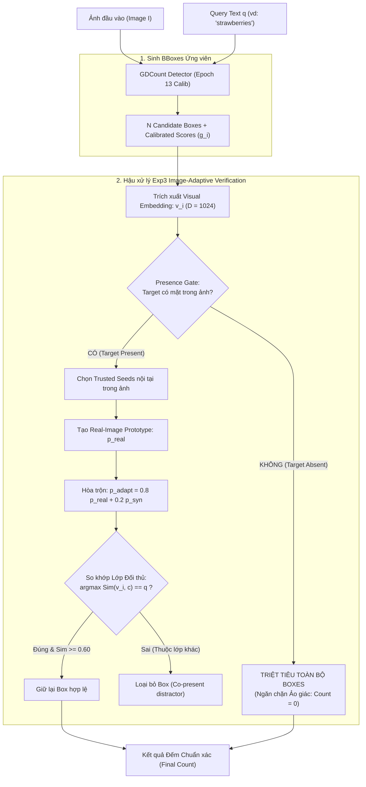

# GDCount + Exp3: Image-Adaptive Anti-Hallucination Zero-Shot Counting

> **Seminar Project CS331 - Computer Vision (UIT VNU-HCM)**  
> **Môi trường thực nghiệm:** Huấn luyện trên GPU NVIDIA RTX 3060 12GB  
> **Checkpoint khuyến nghị:** `gdcount_epoch_013_best.pth` (Calibrated Model)

---

## 🌟 TỔNG QUAN & ĐỘT PHÁ CẢI TIẾN CỦA EXP3

GDCount được xây dựng trên nền tảng **GroundingDINO** (Swin Transformer + BERT) tích hợp module **Small Object Adapter (SOA)** và **ScoreCalibrator**. Trong bản cập nhật này, pipeline được nâng cấp với module hậu xử lý **Exp3 (Image-Adaptive Prototype Refinement)** nhằm giải quyết hai điểm nghẽn nghiêm trọng nhất của bài toán Zero-Shot Counting (ZSC):

### 1. Triệt tiêu Ảo giác khi Đối tượng Vắng mặt (Anti-Hallucination / Target-Absence Gate)
* **Vấn đề (Object-Presence Hallucination - OPH):** Các mô hình counting hiện tại (kể cả SOTA như CountGD, CounTX, CLIP-Count) mặc định giả định đối tượng luôn tồn tại trong ảnh (*Positive-Query Assumption*). Khi nhận prompt hỏi về một vật thể **hoàn toàn không có trong ảnh** (ví dụ: ảnh chỉ có *"quả dâu"* nhưng prompt hỏi *"con voi"*), GroundingDINO vẫn cố ép bounding box lên các quả dâu và đếm ra có 5 - 10 "con voi" trong ảnh.
* **Cải tiến của Exp3:**
  - Tích hợp **Presence Gate** nhị phân: $\hat{z} \in \{0, 1\}$.
  - Khởi tạo bộ hạt giống (Seed Pool) và kiểm tra tính nhất quán tuần hoàn (Sequential Consistency Threshold $\tau_c = 0.70$).
  - Nếu đối tượng vắng mặt, không thể hình thành seed đáng tin hoặc mức độ tương đồng thị giác không đạt ngưỡng $\to$ **Toàn bộ candidates bị triệt tiêu, trả về kết quả chính xác tuyệt đối: $\text{Count} = 0$**.

### 2. Phân tách Chính xác trong Cảnh Đa Vật thể (Multi-Object Co-Presence Disambiguation)
* **Vấn đề:** Khi ảnh chứa đồng thời nhiều lớp đối tượng khác nhau (ví dụ: một đĩa hoa quả có cả *"táo"*, *"cam"* và *"chuối"*), các bộ đếm thông thường rất dễ bị nhầm lẫn hoa văn nền hoặc đếm lấn sang các quả khác loại.
* **Cải tiến của Exp3:**
  - Xây dựng **Ngân hàng Đặc trưng Đối thủ (Competitor Feature Bank)** từ 147 lớp FSC-147.
  - Áp dụng nguyên lý loại trừ đối thủ cạnh tranh:
    $$c^* = \arg\max_{c \in \mathcal{C}} \text{Sim}(v_i, c)$$
  - Nếu candidate box $i$ có đặc trưng thị giác giống lớp khác hơn lớp query ($c^* \neq q$, ví dụ giống quả cam hơn quả táo) $\to$ **Tự động loại bỏ box đó khỏi kết quả đếm**.

### 3. Cơ chế Hậu xử lý Image-Adaptive Prototype ($p_{\text{adapt}}$)
Exp3 là một module **hậu xử lý thuần túy (post-processing)**, không làm thay đổi hay can thiệp vào trọng số backbone:
1. Trích xuất đặc trưng vùng nhìn (ROI Visual Embedding $v_i$) cho từng candidate box do detector sinh ra.
2. Lọc ra các *trusted seeds* có độ tự tin cao nhất trong chính ảnh test để tạo thành **Prototype ảnh thực ($p_{\text{real}}$)** phản ánh chính xác điều kiện chiếu sáng và góc chụp của ảnh.
3. Hòa trộn nhẹ với prototype synthetic theo tỷ lệ $\lambda = 0.20$:
   $$p_{\text{adapt}} = \text{normalize}\left((1 - \lambda) p_{\text{real}} + \lambda p_{\text{syn}}^*\right)$$
4. Đánh giá độ tương đồng thích nghi $s_{\text{adapt}, i} = v_i^T p_{\text{adapt}} \ge \tau_{\text{adapt}}$ ($0.60$) để đưa ra danh sách Bounding Boxes và Số đếm chuẩn xác nhất.



---

## 🛠️ HƯỚNG DẪN CÀI ĐẶT & THIẾT LẬP MÔI TRƯỜNG

### 1. Tạo conda env từ file YAML
```powershell
conda env create -f env.yaml
conda activate gdcount
```

### 2. Cài đặt GroundingDINO
Cần xuất biến môi trường `CUDA_HOME` trước khi build:
```powershell
# Windows PowerShell
$env:CUDA_HOME = "C:\Program Files\NVIDIA GPU Computing Toolkit\CUDA\v12.x"  # Chỉnh theo bản CUDA của bạn
git clone https://github.com/IDEA-Research/GroundingDINO.git
cd ./GroundingDINO
pip install -e . --no-build-isolation
cd ..
```

---

## 🚀 CHẠY ỨNG DỤNG & INFERENCE

### 1. Chạy Streamlit Demo GDCount + Exp3
Bản demo tương tác trực quan với đầy đủ tính năng bật/tắt Exp3, phân tích BBox ảo giác theo màu và vẽ density map:
```powershell
streamlit run app_exp3.py
```
*(Hoặc chạy app cơ bản: `streamlit run app.py`)*

* **DEMO trực tuyến trên Hugging Face Spaces:** [Phiphi216/GDCount](https://huggingface.co/spaces/Phiphi216/GDCount)

### 2. Chạy Script kiểm thử ngoại tuyến (Offline Test)
```powershell
python test_exp3.py --image "CountGD/img/306.jpg" --prompt "strawberries" --threshold 0.23 --adapt_threshold 0.60
```

---

## 📦 CHECKPOINTS & WEIGHTS

* **Link tải Checkpoints đầy đủ:** [Google Drive Folder](https://drive.google.com/drive/folders/1jNEpp15Tcg04G4as1drDZ8MF1IQ9B_cc?usp=sharing)
  * `gdcount_epoch_013_best.pth`: Checkpoint tốt nhất của nhánh Calibration (khuyến nghị cho Exp3).
  * `gdcount_epoch_011_best_fp16.pth`: Bản fp16 gọn nhẹ triển khai web space.
  * `groundingdino_swint_ogc.pth`: Pretrained weights từ IDEA-Research.

---


## 🙏 ACKNOWLEDGEMENTS

Dự án kế thừa và phát triển dựa trên các công trình khoa học xuất sắc:
* [CountGD](https://github.com/niki-amini-naieni/CountGD) (NeurIPS 2024 - Amini-Naieni et al.)
* [GroundingDINO](https://github.com/IDEA-Research/GroundingDINO.git) (IDEA-Research)
* Nghiên cứu bài toán Object-Presence Hallucination (OPH) & PrACo Benchmark (Tran, Ninh, Dung - UIT VNU-HCM, 2026).
