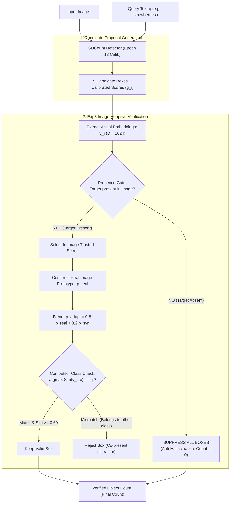

# GDCount + Exp3: Image-Adaptive Anti-Hallucination Zero-Shot Counting

> **Seminar Project CS331 - Computer Vision (UIT VNU-HCM)**  
> **Experimental Environment:** Trained on an NVIDIA GeForce RTX 3060 12GB GPU  
> **Recommended Checkpoint:** `gdcount_epoch_013_best.pth` (Calibrated Model)

---

## 🌟 Overview & Key Innovations of Exp3

GDCount builds upon the **GroundingDINO** open-vocabulary foundation detector (Swin Transformer + BERT), enhanced with a custom **Small Object Adapter (SOA)** and a **ScoreCalibrator** head. In this release, the pipeline is augmented with **Exp3 (Image-Adaptive Prototype Refinement)** post-processing to resolve two fundamental failure modes in Zero-Shot Counting (ZSC):

### 1. Target-Absence Hallucination Mitigation (Object-Presence Hallucination - OPH)
* **The Failure Mode:** Contemporary zero-shot counters operate under an implicit *Positive-Query Assumption*—presuming the queried category is invariably present in the scene. When queried with an object category that does not exist in the image (e.g., querying *"elephant"* on an image containing only *"strawberries"*), standard detectors forcibly project bounding boxes onto salient distractors or background textures, yielding spurious non-zero counts.
* **The Exp3 Solution:**
  - Integrates an explicit binary **Presence Gate**: $\hat{z} \in \{0, 1\}$.
  - Constructs a query-conditioned candidate *Seed Pool* and enforces sequential consistency ($\tau_c = 0.70$).
  - If the target concept is absent or fails to establish a consistent visual seed pool, all candidate proposals are suppressed, rigorously enforcing:
    $$P(\hat{C} = 0 \mid \text{Target Absent}) = 1$$

### 2. Multi-Object Co-Presence Disambiguation
* **The Failure Mode:** In cluttered real-world scenes displaying multiple object categories simultaneously (e.g., a table with *apples*, *oranges*, and *bottles*), baseline counters frequently misidentify visually similar distractors and over-count cross-category objects.
* **The Exp3 Solution:**
  - Employs an offline-indexed **Competitor Feature Bank** spanning 147 FSC-147 categories.
  - Implements competitive argmax class attribution:
    $$c^* = \arg\max_{c \in \mathcal{C}} \text{Sim}(v_i, c)$$
  - Candidates whose visual representations align more strongly with an alternative co-present category ($c^* \neq q$) are pruned as distractors.

### 3. Pure Post-Processing Image-Adaptive Prototype ($p_{\text{adapt}}$)
Exp3 operates strictly at inference time as a modular post-processor, requiring no retraining or fine-tuning of the detector backbone:
1. Extract L2-normalized ROI visual embeddings $v_i \in \mathbb{R}^D$ from candidate proposals.
2. Dynamically aggregate high-confidence *trusted seeds* within the test image into an image-specific **Real Prototype ($p_{\text{real}}$)** that captures scene-level illumination, scale, and perspective.
3. Blend $p_{\text{real}}$ with the canonical synthetic prototype $p_{\text{syn}}^*$ ($\lambda = 0.20$):
   $$p_{\text{adapt}} = \text{normalize}\left((1 - \lambda) p_{\text{real}} + \lambda p_{\text{syn}}^*\right)$$
4. Filter out candidates failing the adapted cosine similarity threshold: $s_{\text{adapt}, i} = v_i^T p_{\text{adapt}} \ge \tau_{\text{adapt}} = 0.60$.



---

## 🛠️ Installation & Environment Setup

### 1. Create Conda Environment from YAML
```powershell
conda env create -f env.yaml
conda activate gdcount
```

### 2. Install GroundingDINO
Ensure the `CUDA_HOME` environment variable is set prior to compilation:
```powershell
# Windows PowerShell
$env:CUDA_HOME = "C:\Program Files\NVIDIA GPU Computing Toolkit\CUDA\v12.x"  # Adjust to your installed CUDA toolkit version
git clone https://github.com/IDEA-Research/GroundingDINO.git
cd ./GroundingDINO
pip install -e . --no-build-isolation
cd ..
```

---

## 🚀 Running Inference & Applications

### 1. Interactive Streamlit Web App (GDCount + Exp3)
Launch the comprehensive Streamlit demo featuring interactive Exp3 toggles, color-coded bounding box attribution (Target vs. Competitor vs. Suppressed), and Gaussian density map overlays:
```powershell
streamlit run app_exp3.py
```
*(Or launch the lightweight baseline interface: `streamlit run app.py`)*

* **Live Demo on Hugging Face Spaces:** [Phiphi216/GDCount](https://huggingface.co/spaces/Phiphi216/GDCount)

### 2. Offline Inference Script
Run single-image inference directly from the command line:
```powershell
python test_exp3.py --image "CountGD/img/306.jpg" --prompt "strawberries" --threshold 0.23 --adapt_threshold 0.60
```

---

## 📦 Checkpoints & Pretrained Weights

* **Download Checkpoints:** [Google Drive Folder](https://drive.google.com/drive/folders/1jNEpp15Tcg04G4as1drDZ8MF1IQ9B_cc?usp=sharing)
  * `gdcount_epoch_013_best.pth`: Best calibrated model checkpoint (recommended for Exp3).
  * `gdcount_epoch_011_best_fp16.pth`: Lightweight FP16 quantized model for web deployment.
  * `groundingdino_swint_ogc.pth`: Pretrained backbone weights from IDEA-Research.

---

## 🙏 Acknowledgements

This project builds upon the foundational research and codebases of:
* [CountGD](https://github.com/niki-amini-naieni/CountGD) (NeurIPS 2024 - Amini-Naieni et al.)
* [GroundingDINO](https://github.com/IDEA-Research/GroundingDINO.git) (IDEA-Research)
* Research on Object-Presence Hallucination (OPH) & the PrACo Benchmark (Tran, Ninh, Dung - UIT VNU-HCM, 2026).
